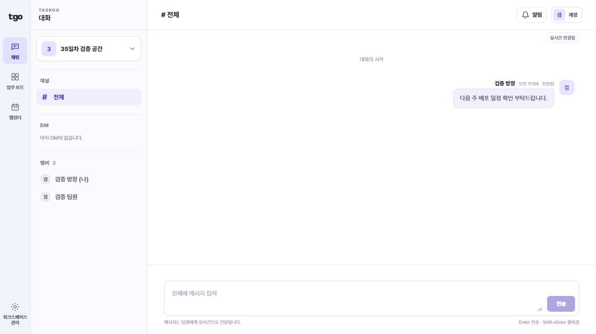
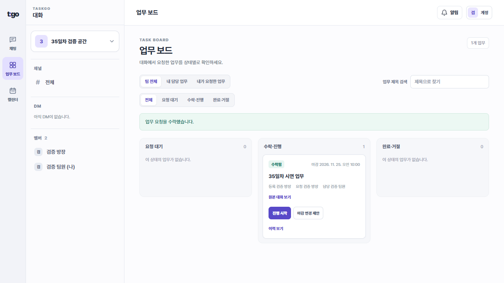
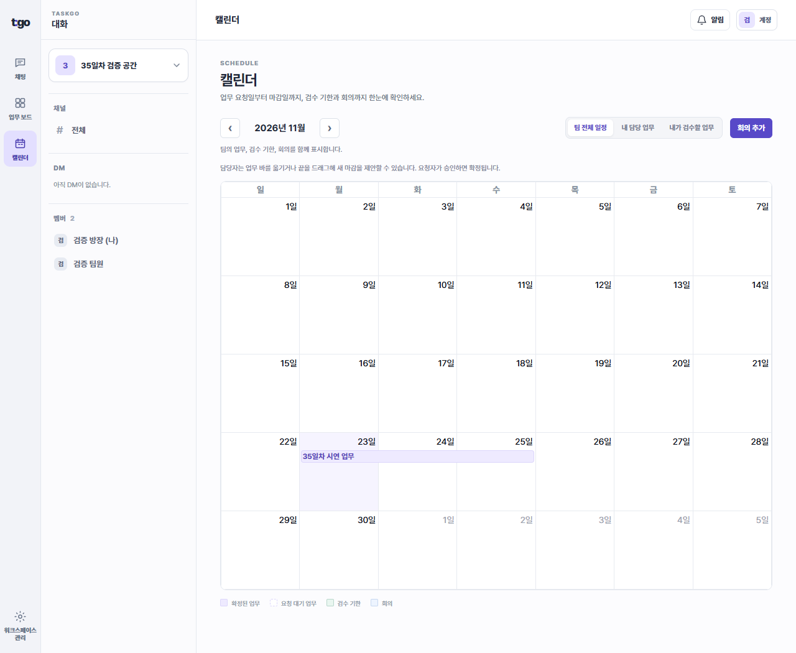
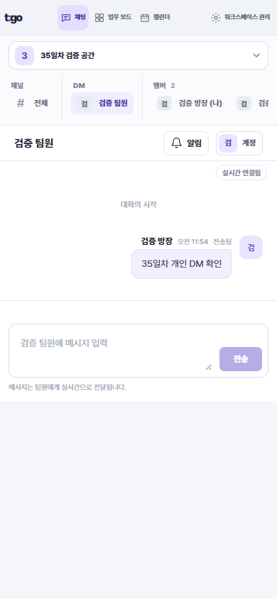
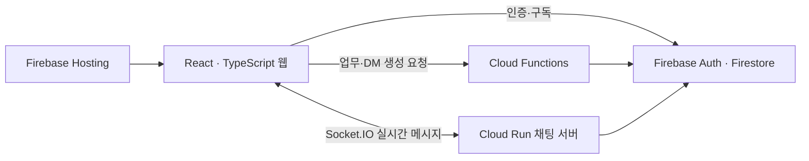

# Taskgo — 채팅에서 업무까지 이어지는 협업 도구

## 한눈에 보기

Taskgo는 워크스페이스의 채널·DM 대화를 업무 요청으로 연결하고, 수락·진행·검수·마감 변경을 보드와 캘린더에서 함께 확인하는 웹 앱이다. 35일 개발 계획에 따라 React·TypeScript 웹, Socket.IO 채팅 서버, Firebase 데이터·인증·Functions를 구현했다.

- [운영 웹 열기](https://taskgo-jins98.web.app)
- [전체 개발 일정](00-roadmap.md) · [35일차 최종 검증](daily/day-35.md)
- 대상: 소규모 팀의 대화와 업무 상태를 한 공간에서 공유하는 데모

## 주요 화면

| 채팅 | 업무 보드 |
|---|---|
|  |  |

| 캘린더 | 모바일 DM |
|---|---|
|  |  |

화면은 2026년 11월 23일 운영 환경의 임시 테스트 워크스페이스에서 촬영했다. 시연 후 테스트 계정과 데이터는 삭제했다.

## 핵심 흐름

1. 이메일·비밀번호 또는 Google 계정으로 로그인하고 표시 이름을 정한다. 워크스페이스를 만들거나 받은 초대 링크로 참여할 수 있다.
2. 채널과 DM에서 실시간으로 대화하고, 메시지에서 업무 요청을 만든다. 요청자·담당자·마감·예상 시간·검수 여부를 지정한다.
3. 담당자는 요청을 수락·거절하고 진행 상태를 바꾼다. 본인을 담당자로 지정한 업무는 즉시 수락 상태가 된다.
4. 업무 보드에서 상태·담당·요청 범위로 찾고, 캘린더에서 요청일부터 마감일까지 이어지는 일정을 확인한다.
5. 팀원 프로필에서 멤버 정보와 개인 DM을 열 수 있다. 검수 요청과 마감 변경은 권한에 따라 처리한다.

## 기술 구성

- 웹: React, TypeScript, Vite, SCSS Modules, Zustand, FullCalendar
- 실시간 채팅: Node.js, Socket.IO, Cloud Run
- 인증·데이터·서버 함수: Firebase Auth, Cloud Firestore, Cloud Functions
- 개발 검증: Firebase Emulator Suite, Playwright 기반 2브라우저 테스트

## 운영 검증 근거

2026년 11월 23일 서로 분리된 Chrome 브라우저 컨텍스트에서 임시 이메일 계정 2개를 만들어 운영 배포를 검증했다. 테스트 전용 워크스페이스와 멤버십을 생성했고, 종료 후 **Auth 계정 2개와 Firestore 문서 13개를 삭제**했다.

| 검증 항목 | 결과 |
|---|---|
| 두 계정 로그인과 Cloud Run 실시간 연결 | 통과 |
| 채널 메시지의 다른 브라우저 실시간 수신 | 통과 |
| 메시지에서 업무 요청 생성, 담당자 수락, 보드 동기화 | 통과 |
| 수락된 업무의 캘린더 기간 표시 | 통과 |
| 팀원 프로필에서 DM 생성, 다른 브라우저의 개인 메시지 수신 | 통과 |
| 390px 모바일 뷰포트 가로 넘침, 브라우저 페이지 오류 | 넘침 없음, 오류 없음 |

배포 시에는 소켓 서버의 허용하지 않은 Origin을 403으로 거절하고 잘못된 Firebase 토큰을 `UNAUTHENTICATED`로 거절하는 것도 확인했다. 코드 품질 검사 `npm run typecheck`, `npm run lint`가 통과했다. 상세 결과와 검증 범위는 [35일차 기록](daily/day-35.md)을 참고한다.

## 운영 비용과 남은 설정

- Cloud Run 소켓 서버는 서울 리전에서 최소 0·최대 1개 인스턴스로 설정했다.
- Taskgo 프로젝트에 월 **5,000원** 예산과 실제 지출 10%·50%·100% 알림을 설정했다. 알림은 청구 상한이 아니다.
- 검수 기한 확인 예약 함수는 1분마다 실행된다. 운영 사용량과 실제 청구액은 Google Cloud 결제 보고서에서 계속 확인해야 한다.
- 초대 메일 발송에는 SMTP 서비스와 발신 주소 설정이 필요하다. 현재 운영 초대 발송은 비활성 상태다. 시연에서는 실제 초대 대신 테스트 전용 멤버십을 등록했다.
- AI 업무 제목 초안에는 OpenAI API 키가 필요하다. 현재 운영에서는 수동 업무 작성이 가능하다.
- 운영 환경에서 Google 로그인, 실제 초대 메일 수신·수락, AI 응답까지 이어지는 외부 연동 시연은 아직 수행하지 않았다.
